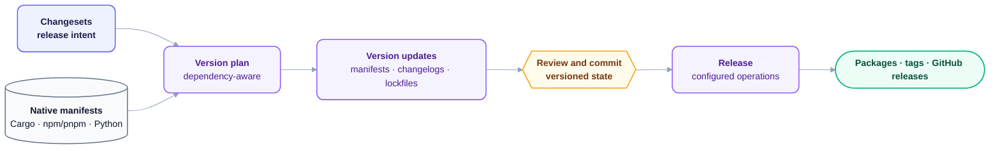

<p align="center">
  <picture>
    <source media="(prefers-color-scheme: dark)" srcset="assets/brand/hero-dark.png">
    
  </picture>
</p>

<p align="center">
  <b>Dependency-aware, changeset-driven versioning and releases for Cargo, npm, and PyPI monorepos.</b>
</p>

<p align="center">
  <a href="https://github.com/orin-dx/callisto/actions/workflows/callisto-ci.yml"></a>
  <a href="LICENSE"></a>
</p>

---

Callisto turns per-package changesets into a version plan for Cargo, npm/pnpm, and Python/PyPI workspaces. It reads native manifests to decide which dependents need updates, then prepares the files and release operations for review.

## A change through Callisto

Suppose `service` depends on a Cargo crate `core` at `^0.2`. A contributor records a minor change to `core`:

```sh
callisto add --package cargo/core:minor --summary "Add streaming API"
callisto version --dry-run
```

With the default cascade policy, the plan is:

| Package | Before | Planned change |
| --- | --- | --- |
| `core` | `0.2.0` | `0.3.0` from the changeset |
| `service` | `1.4.2`, requires `core ^0.2` | `1.4.3` from the default patch cascade; requirement updated to `^0.3` |
| Unrelated npm or Python package | Its current version | No bump just because it shares the repo |

The dependency requirement triggers the `service` bump; sharing a repo does not. Callisto does not infer arbitrary cross-language dependencies. Explicit version groups can couple packages that should move together.

- `callisto version` updates affected manifests, lockfiles, and changelogs for review and commit.
- The release workflow uses native publishers and coordinates configured tags, GitHub releases, and assets. Package owners retain their hooks and credentials.



Callisto is pre-v1. The [guide](docs/how-callisto-works.md) covers current support, known limits, and when another tool may be a better fit, and [stability](docs/stability.md) says what will and will not change.

## What you get

### Versioning from changesets

- Contributors record release intent with `callisto add`, by flags or an interactive wizard. The `.changeset/*.md` files stay compatible with `@changesets/cli` ([stability](docs/stability.md)).
- `callisto status` shows each package's planned bump. `status --check` exits 1 on an error-level diagnostic, so it works as a CI gate ([releasing](docs/releasing.md#pr-pre-flight-verification)).
- `callisto version` bumps manifests, rewrites dependency requirements, writes changelogs, refreshes lockfiles (`--no-refresh-lockfiles` skips that) and stages the result for review ([guide](docs/how-callisto-works.md#a-change-through-the-system)).
- A bump reaches dependents by the `[cascade]` policy: `mode` (`out-of-range` or `always`), `bump-severity`, `peer-escalation` and `preserve-npm-ranges` ([config](docs/config.md#cascade)).
- A mistyped package name gets up to three `did you mean` suggestions, and a wrong ecosystem is caught too ([errors](docs/errors.md)).

### Control over what moves together

- `[[fixed-group]]` members bump in lock-step. `[[linked-group]]` members share the highest severity and align to the highest target version ([config](docs/config.md#fixed-group-and-linked-group)).
- `[[package]]` (exact) and `[[package-set]]` (glob) rules override per package: `release-trigger`, `publish-to`, `tag-template`, `previous-tag-templates` for renamed packages, `changelog` and `pre-major-inference` ([config](docs/config.md#package-and-package-set)).
- `[registries]` adds private or alternate cargo, npm and PyPI registries, each with its own `url`, `publish-timeout` and `confirm-timeout` ([config](docs/config.md#registries)).
- An unknown key in `callisto.toml` is an error, so a typo fails instead of being ignored ([config](docs/config.md)).

### Beyond changesets

- `release-trigger = "auto"` infers bumps from conventional commits. `pre-major-inference` softens them for `0.y` packages that have a prior release: `conservative` turns a major into a minor, and `conservative-feat` also turns a minor into a patch ([config](docs/config.md#package-and-package-set)).
- `callisto pre enter <tag>` and `pre exit` run prerelease mode; the tag must be a valid SemVer prerelease ([errors](docs/errors.md)).
- `callisto snapshot --tag <tag>` writes throwaway versions, such as `0.0.0-<tag>-<sha>` in a Cargo workspace, without writing changelogs or consuming changesets, and `release` refuses to publish them (E169) ([versioning](docs/architecture/versioning.md)).
- `[changelog] layout` chooses `grouped` (Major, Minor and Patch Changes under a dated heading, with a compare link when the GitHub repository is known) or `flat` ([config](docs/config.md#changelog)).

### Releasing

- `callisto release` publishes each package whose current version has no tag, using the ecosystem's own tool (`cargo`, `npm`, `pnpm`, `yarn`, `bun` or Twine), then creates the tag and the GitHub release. `--dry-run` prints the plan first ([releasing](docs/releasing.md#local-release-callisto-release)).
- The order follows dependencies: platform packages publish before their npm owner, and a package's tag and release wait for every one of its registry publishes ([architecture](docs/architecture/release.md)).
- A published version must show on the registry before anything is tagged or announced; `confirm-timeout` sets the wait ([releasing](docs/releasing.md#release-identity-and-recovery)).
- Product binaries are declared with `[release] product-package` and `[[release.artifact]]` entries (package, target triple, asset name) and attach to the product's GitHub release ([config](docs/config.md#release)).
- Tags are `{name}@{version}`, or `ecosystem/name@{version}` when another ecosystem has a package of that name; `tag-template` overrides them ([stability](docs/stability.md)). Release notes come from the package's changelog section.
- One release PR, rebuilt on every push to the default branch, holds the versions, the changelogs and a "Merging will publish" plan. Merging it is the approval ([releasing](docs/releasing.md#release-pr-and-approval)).
- A failed release can be rerun. Versions, tags and releases that already landed are adopted, not repeated, and a receipt is written only when every operation succeeded ([releasing](docs/releasing.md#publication-checks)).
- The generated build workflow attests each Cargo binary asset with GitHub build provenance, and `release execute` checks its SHA-256 and runs `gh attestation verify` before uploading it. npm provenance is on when the publishing job sets `NPM_CONFIG_PROVENANCE` ([publishing](docs/publishing.md#provenance)).
- napi-rs platform packages take their owner's version, and the generated workflow builds each `napi.targets` addon ([releasing](docs/releasing.md#platform-package-publish-order)).

### CI and automation

- `callisto init` detects packages and writes `callisto.toml` and `.changeset/`. With a GitHub origin it also writes `.github/workflows/callisto-release.yml` unless you pass `--no-workflow` ([releasing](docs/releasing.md#generated-workflows)).
- The simple workflow has a `version-pr` job that keeps the release PR current and a `release` job that runs `callisto release` on each default-branch push. With binaries or napi targets it becomes version-pr, plan, build, an optional Python build and execute, and only `execute` gets registry secrets.
- `callisto-action` runs in `mode: version-pr` (create or update the release PR) or `mode: release` (run `callisto release`). `setup-callisto` installs Callisto, checking the release binary with `gh attestation verify` (`verification: require`, `fallback` or `skip`). `callisto-validate` runs `status --check` and `release --dry-run` for your PR workflow ([releasing](docs/releasing.md#pr-pre-flight-verification)).
- To adopt it: run `callisto init`, add the registry secrets it names, and require pull requests and reviews on the default branch.

### Scripting and stability

- `--format json` works on every command that reports a result. Each report carries `schemaVersion`, `command` and `dryRun`, with camelCase fields, and `callisto schema --type <report>` prints its JSON Schema ([stability](docs/stability.md)).
- Exit codes are 0 for success, 1 for failure and 2 for a bad flag or argument. Every error has a code listed in [errors](docs/errors.md).
- `--dry-run` is accepted on every command and changes nothing.
- Release binaries cover macOS (arm64, x86_64) and Linux (x86_64 glibc and musl, arm64) ([install](#install)).

### Limits

- Cargo, npm and PyPI only. `nuget` is accepted in `publish-to`, but there is no NuGet publisher or package discovery ([config](docs/config.md#registries)).
- Dependencies across languages are not inferred; use groups to move packages together ([guide](docs/how-callisto-works.md#current-support)).
- Python versions must be static (PEP 621) or Poetry. Maturin gets no generated workflow, and Cargo plus maturin in one directory fails with E007 ([publishing](docs/publishing.md#current-python-support-limits)).
- Generated workflows are GitHub Actions only, and build only Cargo binaries and napi addons; other products need a manual workflow ([releasing](docs/releasing.md#generated-workflows)).
- A bump inferred from commits shows in `status` and `version`, but the release PR reads changesets only, so add a changeset to release it ([spec](docs/specs/cli.json)).
- A release across several registries is not atomic ([guide](docs/how-callisto-works.md#current-support)).
- Registry credentials are tokens passed to the native tools. OIDC trusted publishing is planned, not built ([plan](docs/projects/OIDC-TRUSTED-PUBLISHING.md)).
- `release` requires the workspace to be at the repository root; `status` and `version` also work in a subdirectory ([releasing](docs/releasing.md#local-release-callisto-release)).
- Windows is not supported ([stability](docs/stability.md)).

## Install

**proto** ([moonrepo/proto](https://moonrepo.dev/proto)), from a release binary:

```toml
# .prototools
[plugins.tools]
callisto = "https://raw.githubusercontent.com/orin-dx/callisto/main/proto/callisto.toml"
```

```bash
proto install callisto
```

**cargo**, built from source (package `callisto-cli`, binary `callisto`):

```bash
cargo install callisto-cli
```

**Release binaries**, from [GitHub Releases](https://github.com/orin-dx/callisto/releases) (tag `callisto@<version>`):

```bash
curl -sL "https://github.com/orin-dx/callisto/releases/download/callisto@<version>/callisto-<target>.tar.gz" | tar -xz
```

Available targets: `aarch64-apple-darwin`, `x86_64-apple-darwin`, `x86_64-unknown-linux-gnu`, `aarch64-unknown-linux-gnu`, `x86_64-unknown-linux-musl`.

## Quick start

Start in a Git repository with an `origin` push URL and registry credentials. This example publishes from your machine; to publish from CI instead, keep the workflow `init` writes and see [releasing](docs/releasing.md).

```bash
# 1. Detect packages, write callisto.toml and .changeset/, preview the first release.
#    With a GitHub origin it also writes the release workflow, and it prints what to do next.
callisto init --yes --no-workflow

# 2. Record a pending change against a package
callisto add --package cargo/my-crate:minor --summary "Add authentication middleware"

# 3. See pending changesets and the version bumps they imply
callisto status

# 4. Commit the configuration and pending change
git add callisto.toml .changeset/
git commit -m "chore: configure releases and record pending changes"

# 5. Consume changesets, bump manifests, update changelogs and lockfiles
callisto version

# 6. Commit the staged release changes; release requires a clean checkout
git commit -m "chore(release): version packages"

# 7. Preview, then publish
callisto release --dry-run
callisto release
```

Drop `--no-workflow` to publish from GitHub Actions instead: a push to the default branch opens a release PR, and merging it publishes. A first release of a Cargo crate needs a `description` and a `license`; Callisto stops with a fix before publishing anything if they are missing.

Run `callisto --help` for prerelease mode, snapshots, CI checks, JSON output, and shell completions.

## Documentation

- [Guide](docs/how-callisto-works.md): release model, example, and supported layouts.
- [Releasing](docs/releasing.md): local and CI workflows, limits, and recovery.
- [Publishing](docs/publishing.md): registry credentials.
- [Configuration](docs/config.md) and [errors](docs/errors.md): references.
- [Contributing](CONTRIBUTING.md) and [security](SECURITY.md): project information.

## License

Mixed: `callisto-model` is MIT; the rest of the workspace is [FSL-1.1-MIT](LICENSE) (becomes MIT two years after each version's release).
