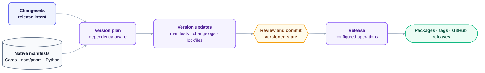

<p align="center">
  <picture>
    <source media="(prefers-color-scheme: dark)" srcset="assets/brand/hero-dark.png">
    
  </picture>
</p>

<p align="center">
  <b>Dependency-aware, changeset-driven versioning and releases for Cargo, npm, and PyPI monorepos.</b>
</p>

<p align="center">
  <a href="https://github.com/orin-dx/callisto/actions/workflows/callisto-ci.yml"></a>
  <a href="LICENSE"></a>
</p>

---

Callisto turns per-package changesets into a version plan for Cargo, npm/pnpm, and Python/PyPI workspaces. It reads native manifests to decide which dependents need updates, then prepares the files and release operations for review.

## A change through Callisto

Suppose `service` depends on a Cargo crate `core` at `^0.2`. A contributor records a minor change to `core`:

```sh
callisto add --package cargo/core:minor --summary "Add streaming API"
callisto version --dry-run
```

With the default cascade policy, the plan is:

| Package | Before | Planned change |
| --- | --- | --- |
| `core` | `0.2.0` | `0.3.0` from the changeset |
| `service` | `1.4.2`, requires `core ^0.2` | `1.4.3` from the default patch cascade; requirement updated to `^0.3` |
| Unrelated npm or Python package | Its current version | No bump just because it shares the repo |

The dependency requirement triggers the `service` bump; sharing a repo does not. Callisto does not infer arbitrary cross-language dependencies. Explicit version groups can couple packages that should move together.

- `callisto version` updates affected manifests, lockfiles, and changelogs for review and commit.
- The release workflow uses native publishers and coordinates configured tags, GitHub releases, and assets. Package owners retain their hooks and credentials.



Callisto is pre-v1. The [guide](docs/how-callisto-works.md) covers current support, known limits, and when another tool may be a better fit, and [stability](docs/stability.md) says what will and will not change.

## Install

**proto** ([moonrepo/proto](https://moonrepo.dev/proto)), from a release binary:

```toml
# .prototools
[plugins.tools]
callisto = "https://raw.githubusercontent.com/orin-dx/callisto/main/proto/callisto.toml"
```

```bash
proto install callisto
```

**cargo**, built from source (package `callisto-cli`, binary `callisto`):

```bash
cargo install callisto-cli
```

**Release binaries**, from [GitHub Releases](https://github.com/orin-dx/callisto/releases) (tag `callisto@<version>`):

```bash
curl -sL "https://github.com/orin-dx/callisto/releases/download/callisto@<version>/callisto-<target>.tar.gz" | tar -xz
```

Available targets: `aarch64-apple-darwin`, `x86_64-apple-darwin`, `x86_64-unknown-linux-gnu`, `aarch64-unknown-linux-gnu`, `x86_64-unknown-linux-musl`.

## Quick start

Start in a Git repository with an `origin` push URL and crates.io credentials. This registry-only example publishes a crate and creates a tag; it does not build assets or create a GitHub Release. See [releasing](docs/releasing.md) for CI and product releases.

```bash
# 1. Scaffold callisto.toml and .changeset/ in the workspace root
callisto init --yes --no-workflow

# 2. Record a pending change against a package
callisto add --package cargo/my-crate:minor --summary "Add authentication middleware"

# 3. See pending changesets and the version bumps they imply
callisto status

# 4. Commit the configuration and pending change
git add callisto.toml .changeset/
git commit -m "chore: configure releases and record pending changes"

# 5. Consume changesets, bump manifests, update changelogs and lockfiles
callisto version

# 6. Commit the staged release changes; release requires a clean checkout
git commit -m "chore(release): version packages"

# 7. Preview, then publish
callisto release --dry-run
callisto release
```

Run `callisto --help` for prerelease mode, snapshots, CI checks, JSON output, and shell completions.

## Documentation

- [Guide](docs/how-callisto-works.md): release model, example, and supported layouts.
- [Releasing](docs/releasing.md): local and CI workflows, limits, and recovery.
- [Publishing](docs/publishing.md): registry credentials.
- [Configuration](docs/config.md) and [errors](docs/errors.md): references.
- [Contributing](CONTRIBUTING.md) and [security](SECURITY.md): project information.

## License

Mixed: `callisto-model` is MIT; the rest of the workspace is [FSL-1.1-MIT](LICENSE) (becomes MIT two years after each version's release).
